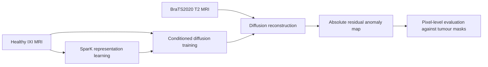
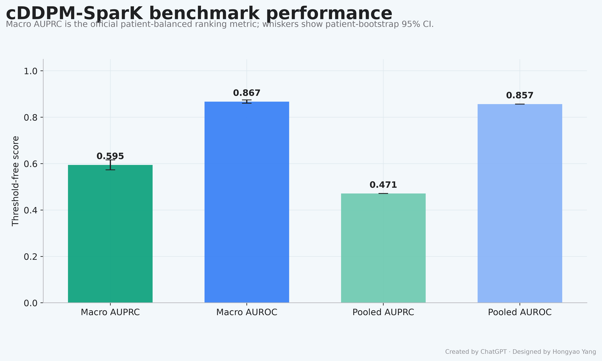
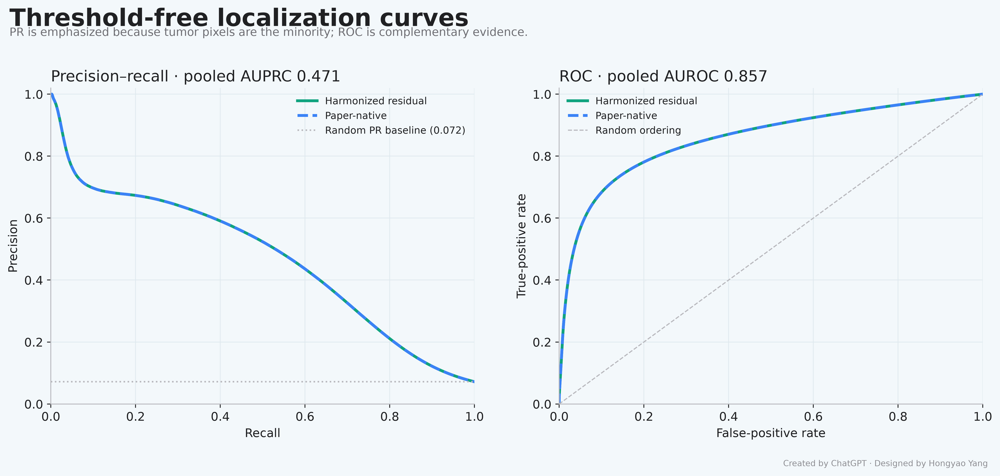
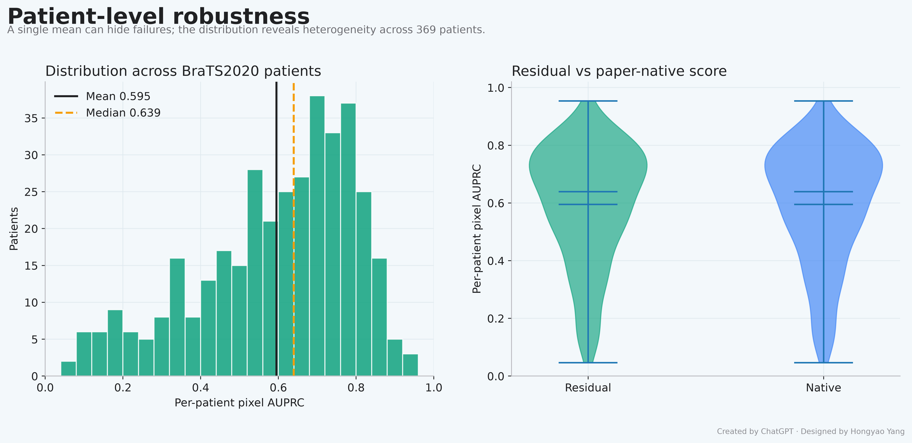

# SparK-cDDPM Anomaly Detection

This repository collects a cDDPM-SparK source snapshot and figures from the SURF brain MRI anomaly-detection project. A healthy-image diffusion model reconstructs an input image; reconstruction residuals provide pixel-level anomaly scores.

## Recorded benchmark results

The figures show the **cDDPM-SparK five-fold ensemble, seed 2026**, evaluated on 369 BraTS2020 patients in the SURF benchmark. Scores are threshold-free pixel-level measures within the evaluation mask. Macro metrics average patient-level scores; pooled metrics aggregate pixels across patients. They answer different questions and are not interchangeable.

The recorded patient-macro AUPRC is **0.595**, macro AUROC **0.867**, pooled AUPRC **0.471**, and pooled AUROC **0.857**. The results are descriptive for this specific evaluation protocol; these figures do not establish clinical performance. No threshold-tuned Dice is claimed. The figure manifest states that metrics were not recomputed when the poster figures were produced.

## Repository structure and provenance

- `source/`: tracked source snapshot of [Conditioned-Diffusion-Models-UAD](https://github.com/FinnBehrendt/Conditioned-Diffusion-Models-UAD), commit `c5904a7`, including the shared implementation and configuration used by the SparK code.
- `analysis/`: SURF poster figure-generation script.
- `figures/`: recorded benchmark summaries.

The source snapshot is a detached clean worktree. **The exact relationship between this snapshot and the historical ensemble checkpoints has not been independently verified.** The figures represent the documented historical run and should not be claimed as results reproduced from this snapshot without checking run manifests and checkpoints.

## Reproducibility

Datasets, trained checkpoints and per-patient predictions are not included. The source environment files provide starting points but may require site-specific dependencies, model resources and path changes. The HPC results used a healthy IXI training workflow and BraTS2020 T2 evaluation; consult the original source documentation and SURF run manifests for preprocessing, split, inference and evaluation details before attempting a rerun.

The source is third-party material; check upstream attribution and licence terms before any public redistribution. This private repository is a research snapshot, not a validated clinical tool.

## Acknowledgement

This project was awarded first place in the Summer Undergraduate Research Fellowship (SURF) at the Academy of Life and Natural Sciences, Xi'an Jiaotong-Liverpool University.
